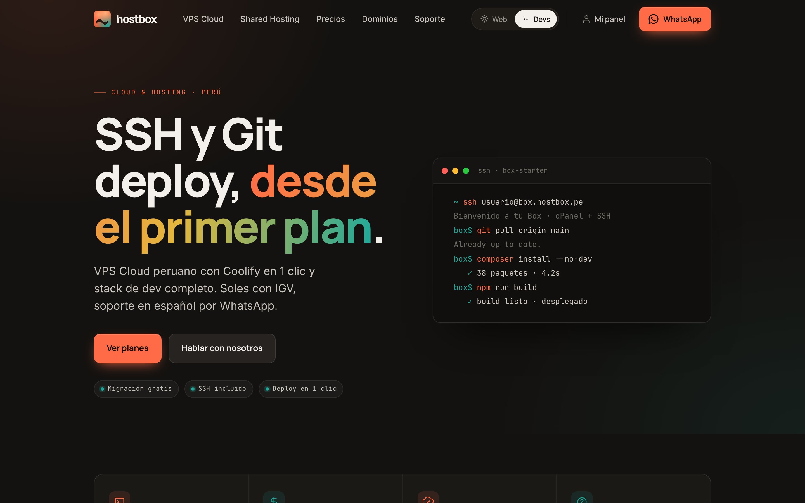

Hostbox es un servicio peruano de hosting compartido y VPS Cloud, activo desde el 8 de diciembre de 2020. Es un proyecto propio: marca, diseño, web e infraestructura.

## Publicar no debería ser perder el control

Hostbox nació de un problema repetido. Al terminar un proyecto, el cliente lo subía a cualquier hosting y ahí se cortaba todo: sin acceso al servidor no había seguimiento, sin seguimiento no había mejoras y, cuando algo fallaba, el soporte llegaba tarde o no llegaba.

La respuesta fue una infraestructura propia, donde publicar sea el comienzo y no el final: un lugar desde el que se puede seguir, mejorar y sostener cada proyecto. Lo que lo distingue cabe en dos ideas: alguien responde del otro lado, y el precio que se ve es el que se paga, en soles, con IGV y sin letra pequeña.

## Dos públicos, una portada

Hostbox tiene dos líneas: hosting compartido con cPanel y SSH desde el plan base, y VPS Cloud con Coolify. Le hablan a dos personas distintas, quien necesita que su web funcione y quien despliega desde Git, así que la portada tiene un selector: **Web** o **Devs**.



Cambian el titular, el texto y el tema: Web va en claro y Devs en oscuro. El contenido vive en colecciones de Astro validadas con Zod. Cada sección tiene su versión por defecto, que es la que leen los buscadores, y una variante opcional por público. Un script de una línea en el `<head>` lee la elección guardada y marca el documento antes del primer pintado, así que no hay parpadeo al entrar. La página conserva un solo `<h1>` en las dos versiones.

Los planes también son datos: un plan al que le falta un campo no llega a publicarse, porque el build falla antes.

## Push a main, despliega solo

El VPS Cloud viene con Coolify instalado: un PaaS propio, al estilo de Heroku o Railway, sobre el servidor del cliente. El repo se conecta a GitHub, el despliegue se configura con el cliente en una llamada (build, variables de entorno, dominio) y desde ahí cada push a main sale solo, con una vista previa por PR. Si un build falla, Hostbox avisa por qué y cómo arreglarlo.

## El dominio del cliente

Las apps de los clientes se sirven desde el servidor de Hostbox, pero el dominio es del cliente y su DNS puede estar en cualquier proveedor. Con Cloudflare for SaaS, el cliente solo apunta su dominio con un CNAME. El certificado se emite y se renueva solo, y el cliente nunca necesita conocer el servidor.

<figure class="diagram">
<svg viewBox="0 0 480 404" role="img" aria-labelledby="hostbox-arq">
<title id="hostbox-arq">Camino de una visita en Hostbox: el dominio del cliente apunta con un CNAME al borde de Cloudflare for SaaS, que termina TLS con un certificado por dominio y pasa la petición al VPS con Coolify, donde corren las apps del cliente. Un push a main en GitHub hace que Coolify despliegue.</title>
<defs>
<marker id="dg-arrow" viewBox="0 0 8 8" refX="7" refY="4" markerWidth="7" markerHeight="7" orient="auto"><path d="M0 0L8 4L0 8z" class="dg-head"/></marker>
<marker id="dg-arrow-accent" viewBox="0 0 8 8" refX="7" refY="4" markerWidth="7" markerHeight="7" orient="auto"><path d="M0 0L8 4L0 8z" class="dg-head-accent"/></marker>
</defs>
<rect x="24" y="8" width="408" height="56" rx="8" class="dg-box"/>
<text x="44" y="32" class="dg-name">Dominio del cliente</text>
<text x="44" y="52" class="dg-meta">tienda.com · un CNAME en su DNS</text>
<line x1="228" y1="64" x2="228" y2="90" class="dg-line" marker-end="url(#dg-arrow)"/>
<rect x="24" y="94" width="408" height="56" rx="8" class="dg-box"/>
<text x="44" y="118" class="dg-name">Cloudflare for SaaS</text>
<text x="44" y="138" class="dg-meta">TLS por dominio · certificado automático</text>
<line x1="228" y1="150" x2="228" y2="176" class="dg-line" marker-end="url(#dg-arrow)"/>
<rect x="24" y="180" width="408" height="100" rx="8" class="dg-box"/>
<text x="44" y="206" class="dg-name">VPS · Coolify</text>
<text x="44" y="226" class="dg-meta">las apps del cliente, cada una con su dominio</text>
<rect x="44" y="242" width="52" height="24" rx="4" class="dg-chip-box"/>
<text x="70" y="258" class="dg-chip">web</text>
<rect x="104" y="242" width="52" height="24" rx="4" class="dg-chip-box"/>
<text x="130" y="258" class="dg-chip">api</text>
<rect x="164" y="242" width="112" height="24" rx="4" class="dg-chip-box"/>
<text x="220" y="258" class="dg-chip">base de datos</text>
<rect x="284" y="242" width="72" height="24" rx="4" class="dg-chip-accent"/>
<text x="320" y="258" class="dg-chip dg-chip-accent-text">deploy</text>
<rect x="24" y="310" width="408" height="56" rx="8" class="dg-box"/>
<text x="44" y="334" class="dg-name">GitHub</text>
<text x="44" y="354" class="dg-meta">push a main · vista previa por PR</text>
<line x1="320" y1="310" x2="320" y2="272" class="dg-loop" marker-end="url(#dg-arrow-accent)"/>
<line x1="24" y1="390" x2="52" y2="390" class="dg-loop"/>
<text x="62" y="394" class="dg-meta">un push a main despliega solo</text>
</svg>
<figcaption>Del dominio del cliente a su app, y de un push al despliegue.</figcaption>
<!--tui
dominio del cliente · un CNAME
   │
   ▼
Cloudflare for SaaS
│  TLS por dominio · cert automático
   │
   ▼
VPS · Coolify
│  web · api · base de datos · deploy
·
GitHub: push a main ┄┄▶ Coolify despliega
-->
</figure>

Con un sitio que ya está en línea, el orden importa para que no se caiga ni un minuto:

```txt
1. hostbox   da de alta el dominio en Cloudflare for SaaS → pide un TXT
2. cliente   agrega el TXT → el certificado queda activo; el sitio sigue igual
3. hostbox   suma el dominio a la app en Coolify y confirma que responde
4. cliente   recién ahora cambia su registro por el CNAME, sin proxy
```

El detalle que más falla está en el paso 4: si el cliente deja el CNAME con el proxy de su propio Cloudflare activado, la petición nunca llega a Hostbox. Por eso va sin proxy.

## El seguimiento, por escrito

Un servicio que promete seguimiento no puede depender de la memoria. El repo de Hostbox tiene skills de Claude que dejan escrito cómo se trabaja: la voz de marca y las frases que no se usan, cómo se agrega contenido sin romper los esquemas, cómo se despliega cada servicio y cómo se da de alta el dominio de un cliente, paso por paso. Con un agente, esos procedimientos se repiten igual cada vez.
