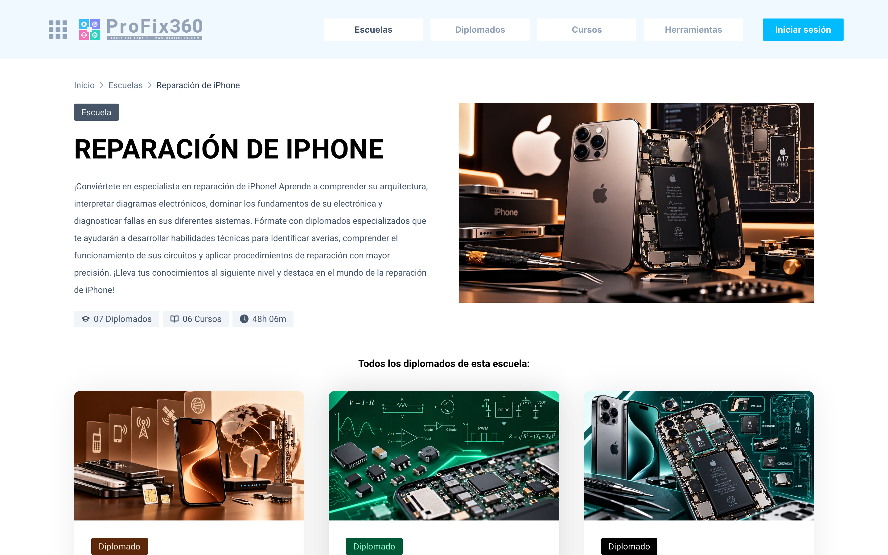
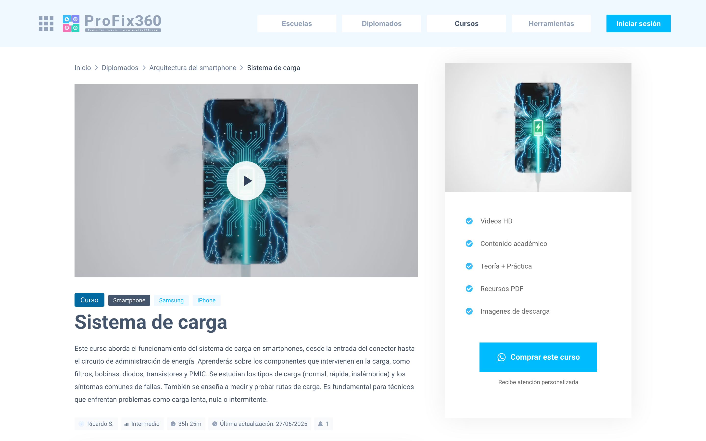

Profix 360 forma técnicos en reparación de celulares. Arrancó en 2023 como PhoneTool, una herramienta en Laravel y Livewire para la comunidad de reparación: planos funcionales, líneas de la placa y pines de cada componente, modelo por modelo. Después se le sumó una academia, y ahí empezó el problema: el cliente quería escuelas, diplomados y ventas por membresía, y cada pantalla nueva había que meterla en un código que no estaba pensado para eso.



## Rehacer sin apagar

En octubre de 2026 se rehízo sobre un monorepo: tres apps en Next.js 16 (Academy, login y dashboard) contra una API en Laravel 13. PhoneTool sigue dentro de esa misma app de Laravel. Lo nuevo vive en módulos (`Academy`, `Billing`, `User`, `Mcp`) y lo heredado se va migrando de a poco.

Escribir lo nuevo era la parte fácil. Lo difícil era no romper lo que ya estaba: usuarios pagando PhoneTool, alumnos a mitad de un curso y URLs que Google ya tenía indexadas.

- La academia anterior sigue abierta un año, para que nadie pierda un curso a medias.
- Cada URL antigua responde con un 301 a su versión nueva.
- phonetool360.com sigue en línea mientras sus usuarios pasan a Profix.
- Los archivos pasaron a Cloudflare R2. Los recursos de las lecciones y los comprobantes de pago solo se entregan a quien tiene acceso.

## Un login para cinco apps

<figure class="diagram">
<svg viewBox="16 0 456 480" role="img" aria-labelledby="profix-arq">
<title id="profix-arq">Arquitectura de Profix 360: el navegador lleva una cookie de sesión en .profix360.com; Academy, Login, Dashboard y PhoneTool hablan con una API de Laravel con módulos y una cola, que usa MySQL y Cloudflare R2. La cola revalida la caché de Academy por webhook firmado.</title>
<defs>
<marker id="dg-arrow" viewBox="0 0 8 8" refX="7" refY="4" markerWidth="7" markerHeight="7" orient="auto"><path d="M0 0L8 4L0 8z" class="dg-head"/></marker>
<marker id="dg-arrow-accent" viewBox="0 0 8 8" refX="7" refY="4" markerWidth="7" markerHeight="7" orient="auto"><path d="M0 0L8 4L0 8z" class="dg-head-accent"/></marker>
</defs>
<rect x="48" y="8" width="416" height="56" rx="8" class="dg-box"/>
<text x="68" y="32" class="dg-name">Navegador</text>
<text x="68" y="52" class="dg-meta">cookie de sesión · .profix360.com</text>
<line x1="256" y1="64" x2="256" y2="92" class="dg-line" marker-end="url(#dg-arrow)"/>
<rect x="48" y="96" width="202" height="60" rx="8" class="dg-box"/>
<text x="64" y="122" class="dg-name">Academy</text>
<text x="64" y="142" class="dg-meta">profix360.com · Next.js</text>
<rect x="262" y="96" width="202" height="60" rx="8" class="dg-box"/>
<text x="278" y="122" class="dg-name">Login</text>
<text x="278" y="142" class="dg-meta">auth. · Next.js</text>
<rect x="48" y="168" width="202" height="60" rx="8" class="dg-box"/>
<text x="64" y="194" class="dg-name">Dashboard</text>
<text x="64" y="214" class="dg-meta">dashboard. · Next.js</text>
<rect x="262" y="168" width="202" height="60" rx="8" class="dg-box"/>
<text x="278" y="194" class="dg-name">PhoneTool</text>
<text x="278" y="214" class="dg-meta">phonetool. · Livewire</text>
<line x1="256" y1="228" x2="256" y2="254" class="dg-line" marker-end="url(#dg-arrow)"/>
<rect x="48" y="258" width="416" height="100" rx="8" class="dg-box"/>
<text x="68" y="284" class="dg-name">API · Laravel</text>
<text x="68" y="304" class="dg-meta">api.profix360.com</text>
<rect x="68" y="320" width="56" height="24" rx="4" class="dg-chip-accent"/>
<text x="96" y="336" class="dg-chip dg-chip-accent-text">cola</text>
<rect x="132" y="320" width="76" height="24" rx="4" class="dg-chip-box"/>
<text x="170" y="336" class="dg-chip">Academy</text>
<rect x="216" y="320" width="64" height="24" rx="4" class="dg-chip-box"/>
<text x="248" y="336" class="dg-chip">Billing</text>
<rect x="288" y="320" width="52" height="24" rx="4" class="dg-chip-box"/>
<text x="314" y="336" class="dg-chip">User</text>
<rect x="348" y="320" width="48" height="24" rx="4" class="dg-chip-box"/>
<text x="372" y="336" class="dg-chip">Mcp</text>
<line x1="149" y1="358" x2="149" y2="384" class="dg-line" marker-end="url(#dg-arrow)"/>
<line x1="363" y1="358" x2="363" y2="384" class="dg-line" marker-end="url(#dg-arrow)"/>
<rect x="48" y="388" width="202" height="44" rx="8" class="dg-box"/>
<text x="149" y="415" class="dg-name dg-center">MySQL</text>
<rect x="262" y="388" width="202" height="44" rx="8" class="dg-box"/>
<text x="363" y="415" class="dg-name dg-center">Cloudflare R2</text>
<path d="M68 332H24V126H44" class="dg-loop" marker-end="url(#dg-arrow-accent)"/>
<line x1="48" y1="462" x2="76" y2="462" class="dg-loop"/>
<text x="86" y="466" class="dg-meta">revalida la caché de Academy por webhook firmado</text>
</svg>
<figcaption>Cinco apps, una sesión y una sola API.</figcaption>
<!--tui
navegador · cookie en .profix360.com
├─ Academy      profix360.com
├─ Login        auth.
├─ Dashboard    dashboard.
└─ PhoneTool    phonetool.
   │
   ▼
API · Laravel   api.profix360.com
│  academy · billing · user · mcp · cola
├─ MySQL
└─ Cloudflare R2
·
cola ┄┄▶ academy: revalida la caché
         por webhook firmado
-->
</figure>

Lo obvio era montar OAuth entre las apps. No hacía falta: todas viven bajo el mismo dominio y comparten la misma base de usuarios. Laravel Fortify inicia la sesión y deja la cookie en el dominio principal, así que cualquier app que la recibe ya sabe quién es. Si falta, la app manda a `/api/authorize`, que pasa por el login y vuelve, pero solo a un destino que sea una de las apps propias.

Cada herramienta nueva se suma en su propio subdominio, con el login y las ventas ya resueltos.

## El catálogo, desde caché

El catálogo es público y es lo que vende, así que tiene que cargar rápido. Academy lo guarda con `use cache` de Next.js, con un tag por escuela, diplomado y curso. Cuando alguien edita un diplomado en el dashboard, Laravel encola un job que llama a un webhook de Academy firmado con HMAC, y se invalida solo ese tag:

```txt
dashboard   PUT degrees/arquitectura-del-iphone
api         observer → encola RevalidateAcademyCache
cola        POST /api/revalidate   (firma + timestamp)
academy     revalidateTag("academy:degree:arquitectura-del-iphone")
```

Lo de cada alumno (avance, accesos, membresías) nunca entra a la caché: se pide desde el navegador.



## Medir el embudo

Academy, el login y PhoneTool cargan un solo contenedor de Google Tag Manager, aunque unas apps son Next.js y otra es Blade. GA4 y Meta Pixel se cargan desde ahí, y sus IDs se cambian en el dashboard sin recompilar nada. Nada usa cookies hasta que el visitante acepta el banner (Consent Mode v2).

Los eventos siguen el camino de una venta: ver una escuela, un diplomado o un curso, abrir una herramienta, registrarse y hacer clic en "Comprar", que abre WhatsApp con el plan elegido.

## Trabajar con un agente

La reconstrucción se hizo con Claude Code. El agente escribía código; las decisiones no eran suyas. Antes de cada fase, lo acordado con el cliente quedaba escrito en el repositorio: un roadmap con la fecha y el motivo de cada decisión, un mapa de arquitectura con diagramas que se actualiza en el mismo PR que cambia una pieza y un `CLAUDE.md` con las convenciones. Así el agente no improvisaba arquitectura y cada sesión arrancaba con el mismo contexto.

Las revisiones también se hicieron con agentes. Playwright recorrió Academy y el dashboard en cinco anchos, de 360 a 1280 px, buscando scroll horizontal, y lo que encontró quedó como test. Lo mismo con el SEO y con las 14 plantillas de correo antes del pase a producción.

La IA también llega al cliente: un servidor MCP con OAuth 2.1 deja que los gestores editen cursos desde ChatGPT o Claude, con los permisos que eligen al autorizar y cada cambio auditado.
