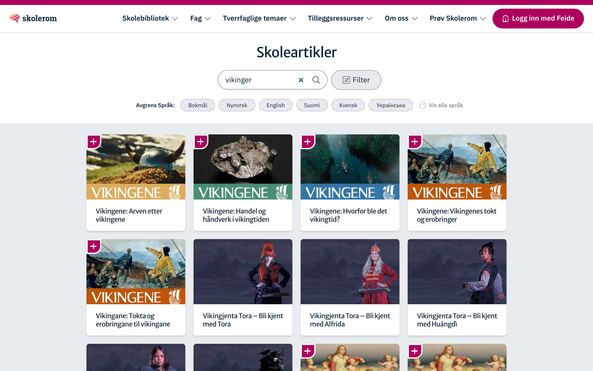

Skolerom es un recurso educativo para colegios de toda Noruega: más de 500 artículos, 300 rutas de aprendizaje y 1 000 ejercicios, en seis idiomas, del bokmål y el nynorsk al kven y el ucraniano. Tiene tres partes: el sitio en WordPress, la app donde se arman las rutas y las tareas, y un portal en Next.js para buscar y filtrar los artículos.

El trabajo empezó en el WordPress y terminó en el frontend principal del portal.

## 22 segundos para buscar

Buscar un artículo tardaba 22 segundos. La app le pedía los resultados directamente a WordPress, y cada artículo y cada filtro disparaban otra petición, una detrás de otra. Ninguna era lenta por sí sola: lo lento era la cascada.

En el portal, una búsqueda es una sola petición paginada a un servicio de búsqueda, con los filtros incluidos: curso, asignatura, elementos centrales del currículo, temas transversales e idioma. TanStack Query se ocupa de lo que viene del servidor y Zustand, del estado de la interfaz. Hoy la página tarda 1,6 s en mostrar resultados (medido en octubre de 2026, desde Lima).



## Que no vuelva a pasar

Los 22 segundos no aparecieron de un día para otro; nadie los vio llegar porque nadie medía. Y no eran el único síntoma: un cambio rompía otra parte y el error aparecía en producción, las ramas duraban semanas y chocaban al unirse, y los despliegues se hacían a mano.

Arreglar la búsqueda no alcanzaba. Hubo que cambiar el camino que recorre un cambio hasta llegar a producción.

<figure class="diagram">
<svg viewBox="0 0 480 324" role="img" aria-labelledby="skolerom-ci">
<title id="skolerom-ci">Camino de un cambio en Skolerom: un PR corto a main con vista previa en Vercel; GitHub Actions corre pruebas end-to-end de Playwright de búsqueda y filtros, rendimiento y accesibilidad; si pasan, se mergea y Vercel despliega el portal, con vuelta atrás al despliegue anterior. Si una prueba falla, el PR no se mergea.</title>
<defs>
<marker id="dg-arrow" viewBox="0 0 8 8" refX="7" refY="4" markerWidth="7" markerHeight="7" orient="auto"><path d="M0 0L8 4L0 8z" class="dg-head"/></marker>
<marker id="dg-arrow-accent" viewBox="0 0 8 8" refX="7" refY="4" markerWidth="7" markerHeight="7" orient="auto"><path d="M0 0L8 4L0 8z" class="dg-head-accent"/></marker>
</defs>
<rect x="24" y="8" width="408" height="56" rx="8" class="dg-box"/>
<text x="44" y="32" class="dg-name">PR corto a main</text>
<text x="44" y="52" class="dg-meta">horas o 1–2 días · vista previa en Vercel</text>
<line x1="228" y1="64" x2="228" y2="90" class="dg-line" marker-end="url(#dg-arrow)"/>
<rect x="24" y="94" width="408" height="100" rx="8" class="dg-box"/>
<text x="44" y="120" class="dg-name">GitHub Actions</text>
<text x="44" y="140" class="dg-meta">Playwright E2E · en cada PR</text>
<rect x="44" y="156" width="148" height="24" rx="4" class="dg-chip-box"/>
<text x="118" y="172" class="dg-chip">búsqueda y filtros</text>
<rect x="200" y="156" width="102" height="24" rx="4" class="dg-chip-accent"/>
<text x="251" y="172" class="dg-chip dg-chip-accent-text">rendimiento</text>
<rect x="310" y="156" width="108" height="24" rx="4" class="dg-chip-box"/>
<text x="364" y="172" class="dg-chip">accesibilidad</text>
<line x1="228" y1="194" x2="228" y2="220" class="dg-line" marker-end="url(#dg-arrow)"/>
<rect x="24" y="224" width="408" height="56" rx="8" class="dg-box"/>
<text x="44" y="248" class="dg-name">main → Vercel</text>
<text x="44" y="268" class="dg-meta">despliegue automático · vuelta atrás si falla</text>
<path d="M432 144H456V36H436" class="dg-loop" marker-end="url(#dg-arrow-accent)"/>
<line x1="24" y1="306" x2="52" y2="306" class="dg-loop"/>
<text x="62" y="310" class="dg-meta">si una prueba falla, el PR no entra</text>
</svg>
<figcaption>Un cambio llega a main, y a producción, solo si pasan las pruebas.</figcaption>
<!--tui
PR corto a main · horas o 1–2 días
│  vista previa en Vercel
   │
   ▼
GitHub Actions · en cada PR
│  Playwright E2E
│  búsqueda y filtros · rendimiento
│  accesibilidad
   │
   ▼
main → Vercel · despliegue automático
│  vuelta atrás si falla
·
falla una prueba ┄┄▶ el PR no entra
-->
</figure>

Las pruebas end-to-end recorren lo que más se usa: buscar, filtrar por curso, asignatura e idioma, y paginar. Una de ellas mide el tiempo de carga y falla si se pasa del umbral, así que la lentitud deja de notarse tarde: rompe el build. Otra revisa la accesibilidad de las páginas clave.

## Trunk-based, y por qué

Antes, el código pasaba por tres ramas: dev, QA y main. Cada cambio esperaba en QA hasta que alguien lo probara y, mientras tanto, se juntaban otros. Cuando por fin llegaba a main, salía un despliegue grande con muchas cosas a la vez, y si algo fallaba costaba saber cuál de todos los cambios había sido.

Con trunk-based, la única rama que importa es main. Cada cambio sale de una rama que dura horas, o uno o dos días, y vuelve como un PR chico: revisión y pruebas antes del merge. Vercel arma una vista previa por PR, y QA y el cliente revisan ahí, sin una rama que bloquee al resto. Lo que entra a main se despliega, y si algo sale mal se vuelve al despliegue anterior.

```txt
antes   dev → QA (espera) → main → un despliegue grande, a mano
ahora   rama de horas → PR + vista previa + E2E → main → Vercel despliega
```

Para un equipo chico y remoto, menos ramas también es menos coordinación: nadie espera a que otro promueva la suya. Desplegar seguido deja de ser un evento; cada entrega es chica y fácil de revertir.

Lo difícil no fue técnico. Hubo que dejar la costumbre de las ramas por entorno, y eso pasa por confiar en las pruebas y en las vistas previas más que en una rama de QA.
