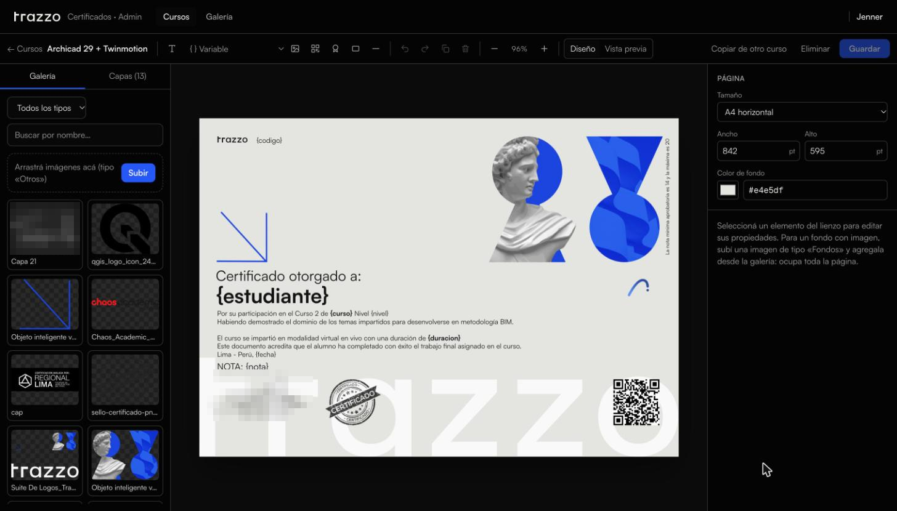
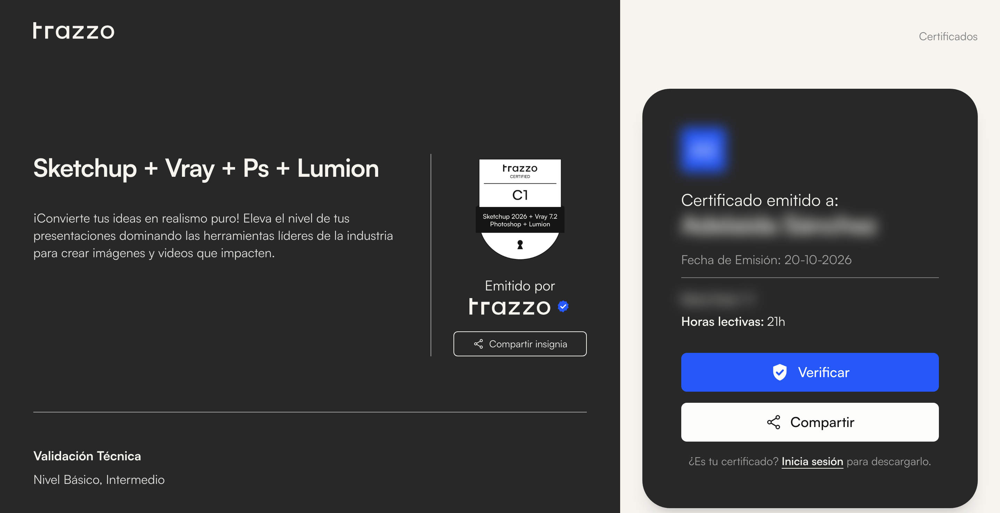

Trazzo es una escuela de visualización arquitectónica, BIM y artes: más de 200 000 alumnos y más de 60 cursos grabados, en vivo y presenciales. Desde 2022 con una web en WordPress; desde 2025, una plataforma propia: la web en Next.js, un panel en Laravel y una app aparte para los certificados. Pagos con OpenPay en dólares y soles, cada moneda con su propio comercio, y membresías que se renuevan solas.

El diseño visual es del equipo de Trazzo; el desarrollo de la plataforma, de punta a punta.

## Tres apps, una API

<figure class="diagram">
<svg viewBox="0 0 480 424" role="img" aria-labelledby="trazzo-arq">
<title id="trazzo-arq">Arquitectura de Trazzo: el navegador lleva una cookie de sesión en .trazzovisual.com; la web con el aula, el panel y la app de certificados hablan con una API de Laravel con módulos de cursos, pagos, certificados y MCP, y una cola. La API usa MySQL, Cloudflare R2, OpenPay en dólares y soles, y Vimeo para las clases. La cola pide a la app de certificados que dibuje cada PDF.</title>
<defs>
<marker id="dg-arrow" viewBox="0 0 8 8" refX="7" refY="4" markerWidth="7" markerHeight="7" orient="auto"><path d="M0 0L8 4L0 8z" class="dg-head"/></marker>
<marker id="dg-arrow-accent" viewBox="0 0 8 8" refX="7" refY="4" markerWidth="7" markerHeight="7" orient="auto"><path d="M0 0L8 4L0 8z" class="dg-head-accent"/></marker>
</defs>
<rect x="24" y="8" width="408" height="56" rx="8" class="dg-box"/>
<text x="44" y="32" class="dg-name">Navegador</text>
<text x="44" y="52" class="dg-meta">cookie de sesión · .trazzovisual.com</text>
<line x1="228" y1="64" x2="228" y2="90" class="dg-line" marker-end="url(#dg-arrow)"/>
<rect x="24" y="94" width="128" height="74" rx="8" class="dg-box"/>
<text x="36" y="118" class="dg-name">Web y aula</text>
<text x="36" y="138" class="dg-meta" style="font-size:11px">trazzovisual.com</text>
<text x="36" y="155" class="dg-meta" style="font-size:11px">Next.js</text>
<rect x="164" y="94" width="128" height="74" rx="8" class="dg-box"/>
<text x="176" y="118" class="dg-name">Panel</text>
<text x="176" y="138" class="dg-meta" style="font-size:11px">dashboard.</text>
<text x="176" y="155" class="dg-meta" style="font-size:11px">Livewire</text>
<rect x="304" y="94" width="128" height="74" rx="8" class="dg-box"/>
<text x="316" y="118" class="dg-name">Certificados</text>
<text x="316" y="138" class="dg-meta" style="font-size:11px">certificados.</text>
<text x="316" y="155" class="dg-meta" style="font-size:11px">Next.js + Konva</text>
<line x1="228" y1="168" x2="228" y2="194" class="dg-line" marker-end="url(#dg-arrow)"/>
<rect x="24" y="198" width="408" height="100" rx="8" class="dg-box"/>
<text x="44" y="224" class="dg-name">API · Laravel</text>
<text x="44" y="244" class="dg-meta">/api/v1 · Sanctum</text>
<rect x="44" y="260" width="62" height="24" rx="4" class="dg-chip-box"/>
<text x="75" y="276" class="dg-chip">Cursos</text>
<rect x="114" y="260" width="56" height="24" rx="4" class="dg-chip-box"/>
<text x="142" y="276" class="dg-chip">Pagos</text>
<rect x="178" y="260" width="96" height="24" rx="4" class="dg-chip-box"/>
<text x="226" y="276" class="dg-chip">Certificados</text>
<rect x="282" y="260" width="44" height="24" rx="4" class="dg-chip-box"/>
<text x="304" y="276" class="dg-chip">MCP</text>
<rect x="358" y="260" width="56" height="24" rx="4" class="dg-chip-accent"/>
<text x="386" y="276" class="dg-chip dg-chip-accent-text">cola</text>
<line x1="228" y1="298" x2="228" y2="322" class="dg-line" marker-end="url(#dg-arrow)"/>
<rect x="24" y="326" width="93" height="52" rx="8" class="dg-box"/>
<text x="70.5" y="348" class="dg-name dg-center" style="font-size:14px">MySQL</text>
<text x="70.5" y="366" class="dg-meta dg-center" style="font-size:11px">datos</text>
<rect x="129" y="326" width="93" height="52" rx="8" class="dg-box"/>
<text x="175.5" y="348" class="dg-name dg-center" style="font-size:14px">R2</text>
<text x="175.5" y="366" class="dg-meta dg-center" style="font-size:11px">PDF y QR</text>
<rect x="234" y="326" width="93" height="52" rx="8" class="dg-box"/>
<text x="280.5" y="348" class="dg-name dg-center" style="font-size:14px">OpenPay</text>
<text x="280.5" y="366" class="dg-meta dg-center" style="font-size:11px">USD · PEN</text>
<rect x="339" y="326" width="93" height="52" rx="8" class="dg-box"/>
<text x="385.5" y="348" class="dg-name dg-center" style="font-size:14px">Vimeo</text>
<text x="385.5" y="366" class="dg-meta dg-center" style="font-size:11px">clases</text>
<path d="M414 272H456V131H436" class="dg-loop" marker-end="url(#dg-arrow-accent)"/>
<line x1="24" y1="404" x2="52" y2="404" class="dg-loop"/>
<text x="62" y="408" class="dg-meta">la cola pide cada PDF a certificados</text>
</svg>
<figcaption>Tres apps, una sesión y una sola API.</figcaption>
<!--tui
navegador · cookie en .trazzovisual.com
├─ Web y aula     trazzovisual.com
├─ Panel          dashboard.
└─ Certificados   certificados.
   │
   ▼
API · Laravel · /api/v1
│  cursos · pagos · certificados · mcp · cola
├─ MySQL     datos
├─ R2        PDF y QR
├─ OpenPay   USD · PEN
└─ Vimeo     clases
·
cola ┄┄▶ certificados: pide cada PDF
-->
</figure>

El backend es la única fuente de verdad: la web, el panel y certificados le hablan por la misma API, y una sola cookie en el dominio principal mantiene la sesión entre las tres. Cuando algo cambia en el panel, la web se entera por un webhook firmado y se actualiza sin esperar un despliegue.

## El aula

El alumno estudia dentro de la misma web. Cada curso se arma por secciones y lecciones: el video de la clase, los recursos para descargar, comentarios por lección y una reseña al final. Cada lección se marca como completada, y ese avance es el que deja el curso listo para el certificado.

Quién puede ver una lección se decide en un solo lugar del backend. Entra quien tiene la inscripción activa, quien toma un curso gratis o quien tiene una membresía que lo cubre, ya sea todo el catálogo o solo algunas categorías. Una inscripción cancelada o suspendida bloquea el curso aunque la membresía lo incluya, y las lecciones de muestra quedan abiertas para todos.

Desde su panel, el alumno ve sus cursos, sus certificados e insignias, su membresía con la suscripción y sus pagos, y su perfil.

## Certificados hechos a mano

Cada certificado se armaba a mano, uno por uno, y se mandaba por correo. No había forma de comprobar que fuera real, y cada edición de un curso terminaba con una tanda de certificados por hacer.

## Lo que se diseña es lo que se imprime

Cada curso tiene su plantilla, que el equipo arma en un editor sobre canvas (Konva): imágenes, textos y variables como `{estudiante}`, `{curso}`, `{nota}` o el QR.



El PDF no tiene un diseño aparte. Para emitir un certificado, el backend le pide a un Chromium sin interfaz que abra una página interna de render, que dibuja la plantilla con **el mismo componente** del editor y devuelve la imagen con la que se arma el PDF. Una sola implementación: si algo se ve bien en el editor, sale igual en el papel.

```txt
nota asignada   el curso se completa o el admin pone la nota
cola            un job por alumno, en lote e idempotente
render          Chromium abre /render → la plantilla se dibuja → PNG
backend         PDF + QR → almacenamiento privado en Cloudflare R2
alumno          correo con su certificado y, si la nota alcanza, su insignia
cualquiera      certificados.trazzovisual.com/{id} para validarlo
```

Los cursos en vivo y presenciales no tienen avance que marcar, así que el certificado también se puede emitir en cuanto hay nota. Los alumnos de esas modalidades se importan desde un Excel.

## Un QR que no se rompe

Cada certificado guarda el dominio de validación con el que se emitió. Si mañana cambia la configuración del curso, los QR que ya están impresos o colgados en LinkedIn siguen llevando al lugar correcto. Un certificado emitido no depende de lo que se cambie después.

La página de validación es pública: muestra el curso, la fecha, las horas y la insignia, y genera su propia imagen para compartir. Descargar el PDF, en cambio, es solo para el dueño: se pide con su sesión y se entrega con un enlace firmado que vence.



## Insignias

Con la nota suficiente, el certificado viene con una insignia del curso. La página de insignias del sitio lista a quienes la tienen y se actualiza sola cada vez que se emite o se retira un certificado, también cuando se borra una inscripción o un alumno.

## Soporte de cobros

Las membresías se cobran como suscripciones de OpenPay. Para revisar un reclamo de cobro sin entrar a la base de datos, el backend expone un servidor MCP de solo lectura: cruza lo que registró Trazzo con lo que cobró OpenPay y señala los casos raros (cobros después de cancelar, suscripciones duplicadas). Las tarjetas salen recortadas a los últimos cuatro dígitos.
